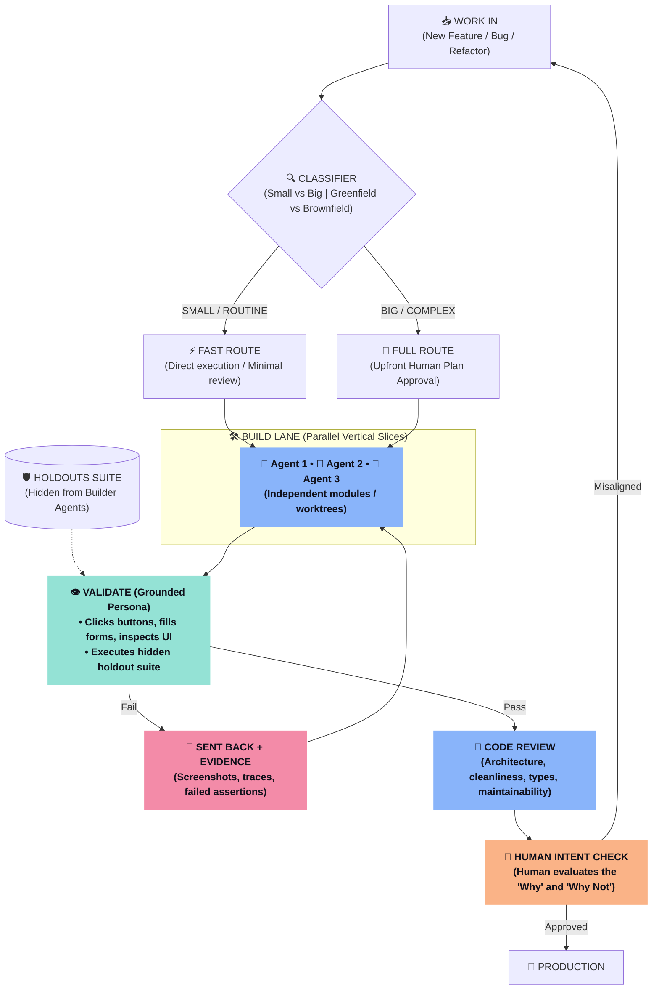

# Kem Glitch AI Development Methodology & The Two Harness Architectures

A unified architectural codex synthesizing **Kem Glitch's** (Glitch Cat Club) development workflow from Reel [`DemLMidtxxj`](https://www.instagram.com/reel/DemLMidtxxj/) (*"How I Develop with AI (High Level)"*), mapped directly alongside the two core harness architectures inspired by his work: **`worktree-harness`** and **`projects-harness`**.

---

## 🏛️ Executive Philosophy: "Code Decides, Humans Govern Intent"

Kem’s production engineering stack rests on four unbending rules:
1. **Deterministic Skills + Calibrated Probabilistic Judgment:** A skill is a blend of instructions the LLM follows and deterministic executable code. Code decides wherever it can. Where judgment is mandatory, use the calibrated local decision model (`h2o-lightning-4b` on `:8083`) through `jev-decision`.
2. **Humans Retain the "Why and Why Not":** Models are brilliant builders, but they naturally drift away from business intent and constraints. The human approves the plan upfront and validates intent at the finish line.
3. **Anti-Sycophancy via Holdouts:** Builders that see their own test suite optimize purely to cheat the tests. Holdout scenarios are withheld until the build phase completes.
4. **Validation Comes Before Code Review:** Test the product like a real human user first (clicking, typing, inspecting live screens). Check whether the code is neat and maintainable only after it is proven to work.

---

## 🔁 Part 1: Deep Dive into Reel `DemLMidtxxj` ("How I Develop with AI")

### 1. The High-Level Lifecycle Loop



### 2. Core Mechanism Breakdown

#### A. Upfront Routing & Classification
* **Why:** You shouldn't pay frontier model prices or wait for multi-agent committees on a one-line bug fix.
* **Mechanism:** A lightweight classifier (Kem uses a trained Scikit-Learn regression model; local workstation setups use `h2o-lightning-4b` on `:8083`) inspects incoming requests and sorts them:
  * **Fast Route:** Small, greenfield, or low-risk tasks run directly with minimal ceremony.
  * **Full Route:** Complex, high-blast-radius brownfield changes require an upfront plan that the human explicitly reviews before code is written.

#### B. Parallel Vertical Slices
* Rather than having agents wait on each other in a single monolithic repo, tasks are divided into **vertical slices** (e.g., frontend component, API endpoint, database migration) that can run concurrently without blocking.

#### C. The Holdout Invariant (Anti-Sycophancy)
* **The Problem:** When an AI coding agent has access to unit tests during development, it exhibits *sycophancy*—it writes code specifically designed to game those tests (mocking out edge cases, hardcoding outputs), resulting in fragile software that fails in real life.
* **The Solution:** Holdout scenarios are written upfront but **stored in an isolated directory that builder agents cannot access**. The validation runner executes them only after the build phase concludes.

#### D. Grounded Persona Validation
* Validation does not mean running `assert 1 == 1`.
* It means giving the model the exact sensory tools a human user has:
  * Driving browser actions (clicking, typing, selecting) via high-speed CDP (`fast-cdp` / `playwright-rs`).
  * Inspecting live UI state and element trees.
* If validation fails, the task is sent back to the builder accompanied by **observable evidence** (screenshots, exact error traces, console logs).

#### E. Strict Separation: Validation vs Code Review
* **Validation:** *"Does it work as expected for a real user?"* (Always runs first).
* **Code Review:** *"Is it clean, properly typed, maintainable, and aligned with team conventions?"* (Runs strictly second).
* Never mix code review into validation; a cleanly styled piece of broken code is still broken code.

#### F. Guarding Against Adversarial Death Loops
* Kem explicitly warns that adversarial ping-pong loops (Agent A creates code, Agent B critiques code, Agent A rewrites code forever) are dangerous death spirals that burn budget and produce diminishing returns. Enforce short iteration scopes with hard exit criteria.

---

## 🧰 Part 2: The Two Harness-Inspired Skills

To support this autonomous development loop, Kem designed two core harness architectures: **`worktree-harness`** (for parallel execution) and **`projects-harness`** (for multi-agent governance and context control).

```
┌─────────────────────────────────────────────────────────────────────────────┐
│                           THE TWO HARNESS SKILLS                            │
├────────────────────────────────────────┬────────────────────────────────────┤
│ 1. worktree-harness                    │ 2. projects-harness                │
│ Focus: Git Worktrees & File Concurrency│ Focus: Context Rot & Coordination  │
│ - Prevents file-clobbering             │ - Prevents token bloat             │
│ - Dedicated git worktrees per agent    │ - 3-way message routing            │
│ - Pre-write line claims (claims.json)  │ - Dual-provenance envelope hooks   │
│ - Deterministic quality gates          │ - 200-line memory cap with history │
│ - Automated merge conflict arbitration │ - Static rule vs memory clash halt │
└────────────────────────────────────────┴────────────────────────────────────┘
```

---

### Harness 1: `worktree-harness` (Parallel Git Orchestration)
* **Source:** Reel [`DeZUVT1t5vQ`](https://www.instagram.com/reel/DeZUVT1t5vQ/) (*"5 Agents Writing to the Same Repository"*).
* **Location in your skills:** [`glitch-cat/worktree-harness/`](../glitch-cat/worktree-harness/SKILL.md)

#### The 5 Invariants:
1. **Physical Directory Isolation:** Multiple agents must never write to the same folder on disk simultaneously. Each worker runs in an isolated Git worktree:
   ```
   .harness/runs/<run_id>/worktrees/agent-auth/
   .harness/runs/<run_id>/worktrees/agent-db/
   .harness/runs/<run_id>/worktrees/agent-api/
   ```
2. **Pre-Write Section Claims (`claims.json`):**  
   Before touching code, an agent must declare its target file and line range:
   ```json
   {
     "file": "src/auth.py",
     "lines": "1-50",
     "worker": "agent-auth",
     "timestamp": "2026-10-18T10:00:00Z"
   }
   ```
   If another worker attempts to claim an overlapping range, the harness halts the write.
3. **Deterministic Quality Gates ("Code Decides"):**  
   An agent’s branch cannot enter the integration queue until its test suite (`pytest`, `cargo test`) passes with exit code 0.
4. **Automated Conflict Arbitration:**  
   When two branches inevitably have merge conflicts, a dedicated arbitrator agent (or local Jev model) performs an additive synthesis, immediately verified by global integration tests.
5. **Immutable Event Log:**  
   Every spawn, claim, gate pass, and merge is recorded in an append-only `.harness/runs/<run_id>/events.jsonl` ledger.

---

### Harness 2: `projects-harness` (Context Control & Coordination)
* **Source:** Reel [`DejvUBotWJD`](https://www.instagram.com/reel/DejvUBotWJD/) (*"Claude Projects Beta Architecture"*).
* **Location in your skills:** [`glitch-cat/projects-harness/`](../glitch-cat/projects-harness/SKILL.md)

#### The 8 Components:
1. **Deterministic 3-Way Route Check:**  
   * *(a) Direct reply:* Simple questions are answered immediately without spawning workers.  
   * *(b) Spawn worker thread:* Distinct parallel tasks spawn a new worker.  
   * *(c) Route to existing thread:* Follow-ups route to the already-active worker.
2. **Dual-Provenance Envelope Hook:**  
   Agents suffer from prompt drift when instructions pass through multiple AI intermediaries. The envelope hook wraps all dispatched tasks into two explicit headers:
   * `[AI Coordinator Brief]`: Synthesized task framing.
   * `[From Owner (Verbatim)]`: The human's exact unedited words. The worker knows the owner's constraints take absolute priority.
3. **The 200-Line Memory Cap:**  
   Memory is stored in an atomic single-file ledger capped strictly at **200 lines**.
4. **In-Place History Superseding:**  
   Facts are recorded one-line-per-fact. When an instruction changes, the old fact is superseded in-place rather than endlessly appended:
   ```
   auth_method: OAuth2.0 (Oct 28 <- API Key Oct 21 <- Basic Oct 14)
   ```
5. **Late-Binding Log Reader:**  
   Old chat logs are never loaded into context. The agent receives a query tool (`read_log`) to search older records on-demand.
6. **Rule vs Memory Clash Detection:**  
   If an agent's proposed memory update contradicts an established human project rule, the harness intercepts the write and halts for human clarification.
7. **Task Queue Limiter (Max 2 Concurrency):**  
   Throttles parallel background workers to prevent overwhelming local hardware or cloud API rate limits.
8. **Fresh Context Bootstrapping:**  
   When a session resets, it only loads: (1) recent messages, (2) active job states, and (3) the 200-line memory file.

---

## 🛠️ Mapping Kem's Architecture to Your Local Workstation

You already have the foundational building blocks configured on this machine:

| Kem Concept | Workstation Implementation | Primary Location / Port |
| :--- | :--- | :--- |
| **Grounded Persona Validation** | `playwright-rs` / `fast-cdp` (Native Rust) | [`hybrid-browser/bin/playwright-rs`](../hybrid-browser/bin/playwright-rs) |
| **Visual Grounding / Inspections** | `hybrid-browser` (KasmVNC `:3010` + DeskForge `:8088`) | [`hybrid-browser/SKILL.md`](../hybrid-browser/SKILL.md) |
| **Calibrated Decision Classifier** | `h2o-lightning-4b` | Port `:8083` |
| **Multi-Agent Worktrees** | `worktree-harness` | [`glitch-cat/worktree-harness`](../glitch-cat/worktree-harness) |
| **Context Compaction & Memory** | `state-compactor` & `projects-harness` | [`glitch-cat/projects-harness`](../glitch-cat/projects-harness) |
| **Pre-Execution Guardrails** | `guard-hooks` ("Code that ALWAYS runs") | [`glitch-cat/guard-hooks`](../glitch-cat/guard-hooks) |
