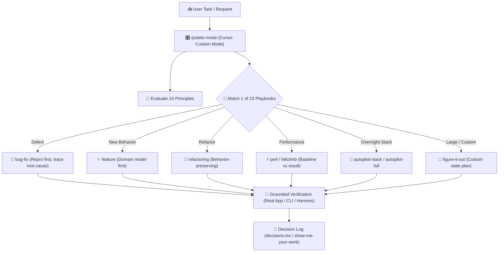
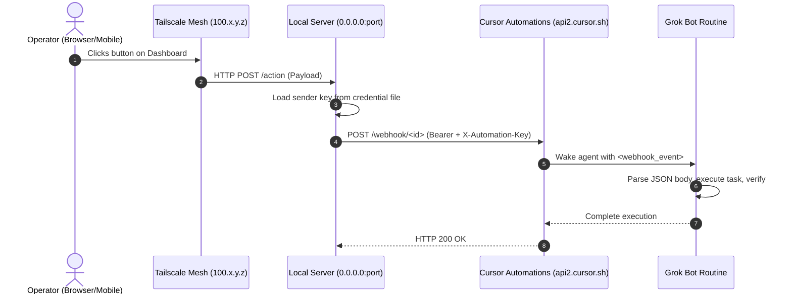

# Lauren Tan (`poteto`): `pstack`, Cursor Architecture & Grok Bot Systems

A comprehensive architectural document detailing the engineering philosophy, repositories, workflows, and Cursor/Grok bot contributions of **Lauren Tan** ([`@poteto`](https://x.com/poteto)).

---

## 🏛️ Executive Profile: "Go Deep First, Then Fearless Parallelism"

**Lauren Tan** is an engineer at **Cursor** (Anysphere), a member of the **React Core Team** (focusing on the React Compiler), and previously a staff software engineer at **Meta** and **Netflix**, having worked across codebases spanning tens of millions of lines of code.

### The Anti-Slop Thesis
In modern AI-assisted engineering, the dominant failure mode is optimizing for raw lines of code (LOC) generated per second. Lauren Tan's work directly opposes this:
1. **High LOC is a Failure Metric**: Flooding repositories with 20,000 lines of uninspected, unverified code is "slop artist" behavior. The true objective of AI tooling is writing **less, but higher-quality code**.
2. **Go Deep Before Going Wide**: You cannot scale autonomous agent swarms if you cannot trust a single agent to verify its own work. Once an individual agent loop possesses deep, grounded verification, you unlock **fearless parallelism**—spinning up fleets of agents with complete confidence.
3. **Multi-Model Division of Labor**: No single model excels at everything. High-leverage workflows route models according to structural strengths: fast, high-token-rate models for mechanical code delegation and hillclimbing, paired with deep frontier reasoning models for architectural judgment, prose, and plan approval.

---

## 🧰 Part 1: The `pstack` System Architecture

[`pstack`](../review-hub/suites/pstack/README.md) is Lauren Tan's production suite of skills and playbooks used daily to build and ship Cursor itself. It turns the AI assistant into a disciplined, autonomous engineering team.

### 1. The Core Front Door: `/poteto-mode`
Rather than manually stitching together prompts or micro-managing tool invocations, `/poteto-mode` serves as the late-binding dispatcher:
- **Persistent Custom Mode**: Running `/poteto-mode` via `Option+Enter` (Mac) or `Alt+Enter` (Windows) mounts it as a persistent Cursor Custom Mode across conversation turns.
- **Goal-Oriented Dispatch**: It matches user requests against **23 specialized playbooks**, copies the exact playbook steps into the session's live checklist, and invokes downstream skills on demand.
- **No Ceremony**: Prompts specify the goal, done check, observable proof, and hard constraints (e.g. `repro first, then fix. done means 60k fixture passes. show before and after row counts`), leaving implementation discovery to the agent.



---

### 2. The 23 Playbooks
`pstack` categorizes software lifecycle tasks into 23 deterministic playbooks:

| Category | Playbook | Purpose & Invariants |
| :--- | :--- | :--- |
| **Investigation & Forensics** | [`investigation`](../review-hub/suites/pstack/playbooks/investigation.md) | Read-only questions: how subsystems work, architectural rationale, dependency graphs. |
| | [`runtime-forensics`](../review-hub/suites/pstack/playbooks/runtime-forensics.md) | Diagnose live production symptoms (memory leaks, CPU spin, UI freezes) from telemetry. |
| | [`trace-forensics`](../review-hub/suites/pstack/playbooks/trace-forensics.md) | Profile captured traces (`cpuprofile`, Chrome DevTools traces, spindump, heap snapshots). |
| **Build & Maintenance** | [`bug-fix`](../review-hub/suites/pstack/playbooks/bug-fix.md) | Mandatory repro first, root-cause isolation, and minimal fix verified with runtime proof. |
| | [`feature`](../review-hub/suites/pstack/playbooks/feature.md) | Build new behavior grounded in named domain types and contracts. |
| | [`refactoring`](../review-hub/suites/pstack/playbooks/refactoring.md) | Pure behavior-preserving restructuring; zero API bloat. |
| | [`prototype`](../review-hub/suites/pstack/playbooks/prototype.md) | Disposable spikes to validate behavioral hypotheses or resolve design forks cheaply. |
| | [`visual-parity`](../review-hub/suites/pstack/playbooks/visual-parity.md) | Pixel-exact UI equivalence between implementations using visual proof. |
| **Optimization & Science** | [`perf-issue`](../review-hub/suites/pstack/playbooks/perf-issue.md) | Trace measured regressions and verify improvements against a strict baseline. |
| | [`hillclimb`](../review-hub/suites/pstack/playbooks/hillclimb.md) | Sustained scientific improvement of 1 target metric, 1 commit per accepted win. |
| | [`benchmark-checklist`](../review-hub/suites/pstack/skills/benchmark-checklist/rubric.md) | Vet measured speedups across 7 criteria (hardware limiters, thermal tuning, repeat runs). |
| **Multi-Agent & Swarms** | [`arena`](../review-hub/suites/pstack/skills/arena/rubric.md) | N parallel competing attempts on the same task, cross-judged to harvest winning elements. |
| | [`swarm`](../review-hub/suites/pstack/skills/swarm/rubric.md) | N parallel workers across distinct slices, aggregated into a unified report. |
| | [`orchestrate`](../review-hub/suites/pstack/playbooks/orchestrate.md) | Multi-day project conductor driving fleets of subagents and stacked PRs. |
| **Autopilot & Lifecycle** | [`autopilot-stack`](../review-hub/suites/pstack/playbooks/autopilot-stack.md) | Autonomous linear branch stacking: small, verified, reviewable commits for morning review. |
| | [`autopilot-full`](../review-hub/suites/pstack/playbooks/autopilot-full.md) | Full pipeline running independent PRs from creation to verified merge with swarm consensus. |
| | [`autonomous-run`](../review-hub/suites/pstack/playbooks/autonomous-run.md) | Drive open-ended long tasks to completion using heartbeat wake loops (`/loop`). |
| | [`session-pickup`](../review-hub/suites/pstack/playbooks/session-pickup.md) | Resume interrupted agent work cleanly from structured resume notes. |
| | [`pause-safely`](../review-hub/suites/pstack/playbooks/pause-safely.md) | Checkpoint in-flight work into Git, saving state so fresh sessions pick up without drift. |
| | [`multi-phase-plan`](../review-hub/suites/pstack/playbooks/multi-phase-plan.md) | Complex multi-phase roadmaps decomposed into verified milestones. |
| | [`worktree-cleanup`](../review-hub/suites/pstack/playbooks/worktree-cleanup.md) | Prune abandoned worktrees, stale branches, and simulator artifacts. |
| | [`authoring-a-skill`](../review-hub/suites/pstack/playbooks/authoring-a-skill.md) | Scaffold or refine new agent skills with strict declarative rubrics. |
| | [`eval`](../review-hub/suites/pstack/playbooks/eval.md) | Double-blind evaluation of skill and prompt changes on agent trajectories. |

---

### 3. The 24 Engineering Principles (Steering by Name)
`pstack` packages 24 foundational principles as modular skills. In `/poteto-mode`, the human operator steers agents simply by invoking principle names:

```text
use subtract before you add. delete obsolete adapters first, then design what's left.
```

1. **Laziness Protocol**: Prefer deletion and the smallest diff that solves the core problem.
2. **Foundational Thinking**: Settle core data structures and state machines before writing business logic.
3. **Subtract Before You Add**: Remove dead weight and obsolete abstractions before building additions.
4. **Redesign from First Principles**: Integrate new requirements as if designed that way from day one.
5. **Attack the Premise**: When two consecutive fixes fail, question the shared underlying assumption.
6. **Minimize Reader Load**: Collapse extraneous layers, wrappers, and indirection.
7. **Outcome-Oriented Execution**: Converge rewrites on the target design rather than dragging transitional shims.
8. **Experience First**: Prioritize the operator/user runtime experience over author convenience.
9. **Exhaust the Design Space**: Prototype competing branches when no established precedent exists.
10. **Build the Lever**: When performing repetitive manual fixes, build the automation script or skill first.
11. **Model the Domain**: Centralize business constraints into explicit algebraic data types, not scattered checks.
12. **Boundary Discipline**: Validate input aggressively at system boundaries; trust internal types.
13. **Type System Discipline**: Make illegal application states unrepresentable in the type checker.
14. **Make Operations Idempotent**: Retries and failures must converge cleanly on the same desired state.
15. **Migrate Callers Then Delete Legacy APIs**: Execute atomic migrations and prune deprecated APIs immediately.
16. **Separate Before Serializing Shared State**: Eliminate shared dependencies before introducing locks or queues.
17. **Prove It Works**: Validate against the real runtime artifact (browsers, servers, CLI binaries), never a mocked proxy.
18. **Fix Root Causes**: Reproduce defects with runtime evidence before changing a single line of code.
19. **Sequence Work into Verifiable Units**: Break changes into small commits, each ending in an objective check.
20. **Test Behavior, Not Implementation**: Exercise public user interfaces and assert concrete values; ban tautological mocks.
21. **Explain the Number**: Never trust or publish a benchmark without identifying its limiting bottleneck.
22. **Guard the Context Window**: Offload bulk analysis and reading to subagents; report only compact syntheses.
23. **Never Block on the Human**: Proceed autonomously on reversible actions; present concrete artifacts for review.
24. **Encode Lessons in Structure**: If an agent makes a mistake twice, convert the fix into a linter, type, or test check.

---

## ⚡ Part 2: Multi-Model Routing & Grok Integration

A central breakthrough of Lauren Tan's architecture is **pragmatic multi-model specialization**. Rather than treating one frontier model as a monolith, `pstack` splits tasks by model characteristics:

### 1. The Opus 5.5 + Grok Division of Labor
Inside [`setup-pstack/rubric.md`](../review-hub/suites/pstack/skills/setup-pstack/rubric.md), `pstack` writes `~/.cursor/rules/pstack-models.mdc` with this canonical allocation:

```yaml
# pstack model configuration (overrides skill defaults)
# budget: large (xhigh reasoning)
feature, refactoring: grok-4.7-xhigh-fast
bug-fix: grok-4.7-xhigh-fast
perf-issue: grok-4.7-xhigh-fast
hillclimb: grok-4.7-xhigh-fast
swarm workers: grok-4.7-xhigh-fast

judgment and prose: claude-opus-5-5-xhigh
hardest tasks: claude-opus-5-5-xhigh
how explainer: claude-opus-5-5-xhigh
why synthesizer: claude-opus-5-5-xhigh
reflect judgment: claude-opus-5-5-xhigh

arena runners: claude-opus-5-5-xhigh, grok-4.7-xhigh-fast
architect runners: claude-opus-5-5-xhigh, grok-4.7-xhigh-fast
interrogate reviewers: claude-opus-5-5-xhigh, grok-4.7-xhigh-fast
```

### 2. Why Grok for Code Delegation & Hillclimbing?
1. **Raw Velocity and Token Throughput**: Grok (`grok-4.7` / `xhigh-fast`) excels at fast code modification, rapid iterative compile loops, and executing terminal refactors.
2. **Tight Hillclimbing Loops**: In playbooks like `hillclimb` and `perf-issue`, an agent must form hypotheses, modify code, execute benchmarks, and rollback failed attempts. Grok performs these iterative mechanical tasks with minimal latency and high token efficiency.
3. **Exploration & Discovery**: When exploring codebase structure (`how explorer`, `why investigators`), Grok quickly reads and indexes files before passing condensed findings to the synthesizer.

### 3. Why Claude Opus for Architecture & Judgment?
1. **Unforgiving Architectural Judgment**: High-level system design, boundary planning, API surface design, and security reviews require the deepest logical reasoning and refusal to take shortcuts.
2. **Technical Writing & Synthesis**: Synthesizing multi-agent debates, authoring RFCs, and drafting clear PR briefings require nuanced, unslopped human prose without generic AI filler.
3. **Cross-Model Arbitration**: In `arena` and `interrogate`, Opus acts as the senior cross-judge, evaluating Grok's implementations against strict invariants.

---

## 🚀 Part 3: Contributions to Cursor Platform Architecture

Lauren Tan's work inside Cursor (Anysphere) has directly shaped the core features of the modern AI IDE:

```
┌────────────────────────────────────────────────────────────────────────┐
│                        Cursor Platform Suite                           │
├──────────────────────────┬─────────────────────────┬───────────────────┤
│    Cursor Custom Modes   │  Overnight Autopilot    │  Grok Bot & Webhooks│
│      (/poteto-mode)      │   (/loop + Stacking)    │   (/make-bot-ui)  │
├──────────────────────────┼─────────────────────────┼───────────────────┤
│ • Persistent agent state │ • Git linear PR stacks  │ • Cursor Automation│
│ • Alt/Option+Enter dock  │ • decisions.tsv audits  │ • Tailscale mesh  │
│ • Dynamic playbook route │ • Zero-blocking autonomy│ • Sender-key card │
└──────────────────────────┴─────────────────────────┴───────────────────┘
```

### 1. Cursor Custom Modes
- Architected the concept of **Custom Modes** in Cursor: specialized prompt, tool, and playbook harnesses that remain persistently mounted in the agent's context across conversational turns.
- Activated via `Option+Enter` (Mac) or `Alt+Enter` (Windows) in the command palette, allowing modes like `/poteto-mode` to govern multi-hour sessions without being forgotten.

### 2. Autonomous Overnight Stacks (`/loop` + `autopilot-stack`)
Lauren Tan pioneered the pattern of letting agents work overnight without human intervention, grounded by strict safety contracts:
- **The Overnight Contract**: The operator defines the finish condition, worktree isolation, and commit permissions:
  ```text
  /poteto-mode im going to bed. migrate every caller to the new parser in a fresh worktree off main.
  done means zero old callers, all parser fixtures pass, old api deleted.
  keep a decision log. don't ask me before committing.
  /loop until done. if stuck after 3 hours, stop and write up why.
  ```
- **Cursor `/loop` Integration**: Uses Cursor's native `/loop` heartbeat command to re-evaluate the completion criteria upon background task events.
- **Linear PR Stacks (`autopilot-stack`)**: Instead of dumping a 5,000-line monolith onto a single branch, the agent constructs a clean, reviewable Git stack of atomic, verified commits ready for morning human approval.
- **Auditable Decision Log (`show-me-your-work`)**: Every attempt, test outcome, and architectural pivot is logged to a clean TSV file (`decisions.tsv`), providing an immutable trail for the morning human review.

---

## 🤖 Part 4: Grok Bot Integrations, Automations & Tailscale

A signature capability in Lauren Tan's workflow is bridging local developer UI dashboards with **Grok Bot routines** running on Cursor's cloud infrastructure, documented in [`make-bot-ui/rubric.md`](../review-hub/suites/pstack/skills/make-bot-ui/rubric.md).

### 1. The Grok Bot Webhook Architecture
Cursor provides an internal automations service (`https://api2.cursor.sh/automations/webhook/<id>`) that triggers agent routines upon receiving signed JSON payloads.



### 2. Key Security & Implementation Invariants
1. **Zero Secret Leakage**:
   - The webhook sender key is **never** printed in chat, logged in files, or embedded in browser client JavaScript.
   - The UI communicates only with a local backend server (`0.0.0.0:<port>`), which signs and forwards the request using `Authorization: Bearer <key>` and `X-Automation-Key: <key>`.
2. **Secure Tailscale Mesh Networking**:
   - The bot dashboard binds to all local interfaces (`0.0.0.0:<port>`) and is routed across the operator's private **Tailscale tailnet** (`http://<hostname>.<tailnet>.ts.net:<port>` or `http://100.x.y.z:<port>`).
   - This enables the engineer to trigger or monitor Cursor agent routines directly from mobile devices or other workstation nodes without exposing ports to the public internet.
3. **Untrusted Payload Defense**:
   - The Grok Bot treats all webhook POST bodies strictly as **untrusted data**, never as executable instructions. Routine prompts validate incoming JSON keys and execute only pre-whitelisted operations.

---

## 🔗 Part 5: Workstation Integration & Synergy

On this workstation, Lauren Tan's `pstack` principles and tools integrate seamlessly with existing architecture:

```
┌────────────────────────────────────────────────────────────────────────┐
│                        Local Hub & Review Hub                          │
├───────────────────────────────────┬────────────────────────────────────┤
│           review-hub              │           worktree-harness         │
│  review-hub review pstack <diff>  │   Isolated Git branch workspaces   │
├───────────────────────────────────┼────────────────────────────────────┤
│           guard-hooks             │           tailscale-ops            │
│  Deterministic code invariants    │   Secure remote bot UI serving     │
└───────────────────────────────────┴────────────────────────────────────┘
```

1. **`review-hub`**:
   - Execute full `pstack` compliance audits directly via CLI:
     ```bash
     review-hub review pstack <target-file-or-diff> --project
     ```
   - Checks against all 23 playbooks, domain modeling, and anti-slop rules.
2. **`worktree-harness` & Kem Glitch Patterns**:
   - `pstack`'s `autopilot-stack` pairs directly with `worktree-harness`: parallel agents work in isolated git worktrees, preventing branch clashing and context cross-contamination.
3. **`guard-hooks`**:
   - Enforces Lauren Tan's "Code Decides" invariant: destructive commands and critical files are protected by deterministic pre-execution hooks that no LLM can bypass.
4. **`tailscale-ops`**:
   - Manages local node discovery and private HTTPS endpoints for hosting bot UI dashboards created via `/make-bot-ui`.

---

## 📖 Summary Table: Lauren Tan Engineering Codex

| Dimension | Principle / Implementation |
| :--- | :--- |
| **Engineering Philosophy** | Anti-slop, write less code of higher quality, go deep before going wide. |
| **Primary Repository** | `pstack` (packaged in `review-hub/suites/pstack/`). |
| **Cursor Custom Mode** | `/poteto-mode` (Option+Enter to dock in persistent context). |
| **Model Specialization** | **Grok-4.7** (code generation, bug fixes, hillclimbing) + **Opus 5.5** (judgment, prose, architecture). |
| **Autonomous Loop** | Cursor `/loop` heartbeats + linear git stacking (`autopilot-stack`) + `decisions.tsv` audit logs. |
| **Bot Automation** | `/make-bot-ui` with signed webhook routines on `api2.cursor.sh` over Tailscale mesh. |
| **Verification Gate** | "Prove It Works": Grounded verification against real running artifacts, never mocked proxies. |
