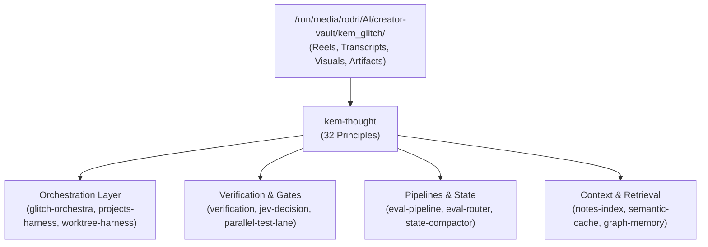

# Glitch Cat Skills — Architecture & Context Contract (`glitch-cat/CONTEXT.md`)

Contract defining the architecture, provenance chain, and operational topology of the 18 Glitch Cat skills.

---

## 1. Provenance Architecture

All skills in this directory originate from Kem Glitch (@kem_glitch / Glitch Cat Club) reels and Claude.ai artifacts mined into `/run/media/rodri/AI/creator-vault/kem_glitch/`.

---

## 2. Skill Roster & Ingestion Map

| Skill | Primary Role | Primary Local Ports / Dependencies | Provenance Reels |
| :--- | :--- | :--- | :--- |
| `kem-thought` | 32 Core steering principles & `/kem-mode` front door | Text-only (`references/provenance.md`) | 27+ reels catalogued |
| `kem-dev-loop` | 6-phase development lifecycle (holdouts + vertical slices) | Local git, test lanes | `DemLMidtxxj` |
| `jev-decision` | Calibrated non-generative decision engine (bool/choice/score) | `:8083` (`h2o-lightning-4b`) | `DdjOqRYNZZi`, `ByzBzHZwz1Y` |
| `verification` | Hands-and-eyes verification gate & storybook/pixel check | Playwright, CDP, Chromium | `DfAIPrAtteM` |
| `eval-pipeline` | Propagation risk mitigation & intermediate disk ledger | Python, `step_NN.json` | `DeHK65INHqh` |
| `eval-router` | Complexity routing with shadow evaluation & failure harvesting | `:8083`, OpenRouter free | `DdWLJa2tjq6` |
| `notes-index` | Local SQLite FTS5 search & verbatim cite verification | SQLite FTS5 (`notes.db`), Python | `DezGALzNCuf`, `DfFSZDvN6oV` |
| `parallel-test-lane` | Regression suite lane partitioning (isolated vs parallel) | Python test runner, pytest | `DbSgqTXt-3c` |
| `worktree-harness` | Parallel subagents writing to isolated git worktrees | `git worktree`, file locking | `DeZUVT1t5vQ` |
| `swarm-contract` | Swarm governance, hit-list goals, immutable budget ceilings | Python contract validator | `DeW6_fqt-cq` |
| `state-compactor` | Zero-loss continuous session compaction (`cgate` reader) | `:8080`, `.agent_state.json` | `DdyqnietB8C`, `DeEyZPEtkyH` |
| `projects-harness` | Multi-agent CLI harness with 3-way routing & provenance | Python, memory envelopes | `DejvUBotWJD` |
| `glitch-orchestra` | Claude Code conductor architecture & specialist panes | Terminal sessions | `Dd_vZqINEtW`, `DeKBMCQNRXU` |
| `guard-hooks` | Pre-execution refusal gates for destructive commands | Bash hooks, regex filters | `DclKZARteCP` |
| `semantic-cache` | Sub-10ms query bypass via vector cosine similarity | `:8087` (bge-small-en-v1.5) | `DdbQeb5t2u0` |
| `graph-memory` | Deterministic SQLite k-hop graph + hybrid BM25 search | SQLite, `bge-small` | `DcTIPKyt7Am`, `DcqtyTStpsw` |
| `agentic-engineering` | 7-step software factory (Kanban + Unbiased Judge) | `.kanban/`, Git | `DehIT3lNgHC` |
| `frontend-uat` | Sub-second model-backed frontend acceptance loop | CDP, `:8083` | Mined vault capture |

---

## 3. Harness Concurrency Contracts

Refer to `harnesses/` for runtime-specific constraints:
- `t3-code.md`: ACP delegate orchestration, `isolation: "worktree"`, preview tools.
- `gemini-antigravity.md`: Native Python `run_workflow` graphs, surgical diffs.
- `opencode.md`: Local daemons (`:8080`, `:8083`), compound bash batching.
